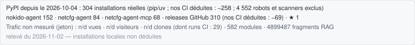

# ⚡ Nokido

### 构建人工有机体 —— 而非又一个 AI Agent

> **一个能够学习、记忆、自我调节的系统 —— 运行在你的机器上，使用你的硬件，服务于你的数据。**

[](../../LICENSE)
[](https://www.python.org/)
[](https://deno.land/)
[](../../go_services/forge_brain_worker/)
[](https://snntorch.readthedocs.io/)
[](https://qdrant.tech/)
[](../../go_services/forge_dispatcher/)
[](#-连接外部智能体)
[](#-security)
[](https://github.com/Nokido-labs/nokido)
[](https://github.com/Nokido-labs/nokido/actions/workflows/release.yml)

**MCP clients & runtimes :**
[](https://github.com/ggml-org/llama.cpp)
[](#-连接外部智能体)
[-MCP%20HTTP-5C2D91?logo=google&logoColor=white)](#-连接外部智能体)
[](#-连接外部智能体)
[](#-连接外部智能体)
[](#-连接外部智能体)
[-MCP%20HTTP-6E56CF?logoColor=white)](https://zcode.z.ai/en)
[](https://github.com/mistralai/mistral-vibe)
[](https://github.com/mammouth-ai/code)

**LLM providers (20 vendors · 39 routed slots, by use-case) :**
[](https://ollama.com/)
[](https://groq.com/)
[](https://www.cerebras.ai/)
[](https://mistral.ai/)
[](https://cohere.com/)
[](https://huggingface.co/)
[](https://github.com/marketplace/models)
[](https://workers.cloudflare.com/)
[](https://build.nvidia.com/)
[](https://sambanova.ai/)
[](https://lmstudio.ai/)
[](https://ai.google.dev/)
[](https://anthropic.com/)
[](https://openrouter.ai/)
[](https://openai.com/)
[](https://www.deepseek.com/)
[](https://z.ai/)
[](https://www.moonshot.cn/)

**Languages:** [English](../../README.md) · [Français](../../docs/i18n/README.fr.md) · [Español](../../docs/i18n/README.es.md) · [简体中文](../../docs/i18n/README.zh-CN.md) · [Português](../../docs/i18n/README.pt-BR.md) · [日本語](../../docs/i18n/README.ja.md) · [Deutsch](../../docs/i18n/README.de.md) · [العربية](../../docs/i18n/README.ar.md)

---

## 🧭 一分钟了解 Nokido

Nokido 是一个**面向人工生命体的本地优先运行时**：它提供神经系统与生理机能，让多个 AI —— 本地模型、云端
服务商，以及 Claude Code、Codex CLI、OpenCode、Antigravity 等编码智能体 —— 在你的机器上协同工作，
**而不会沦为一堆各自为政的智能体**。

它源于三个观察，详见[宣言](MANIFESTO.en.md)：

1. **大多数 AI 在外部。** 提示词、代码和文档都要经过不属于你的基础设施。
2. **大多数 AI 没有记忆。** 记忆只是附加功能，而不是根基。
3. **大多数 AI 只有一个大脑。** 一个大模型回答一切，而生物学表明智能是分布式、专业化的。

Nokido 不是再多一个智能体框架，而是在模型周围加上一层**生命体层**：

* 按用途在本地与云端模型之间**路由**，并可回退到本地；
* **带来源追溯的长期记忆** —— 对系统所学内容进行全文与向量检索；
* 对 CPU、内存、队列和服务商进行**调节** —— 稳态、反射、昼夜节律；
* 围绕动作的**确定性门禁** —— AST 检查、密钥扫描、RBAC、出站（egress）控制；
* **智能体间消息**（M2M、蜂群）以及对自身代码和状态的**内省**；
* 客户端通过 MCP 连接的**唯一枢纽**：客户端可随时替换，系统持续存在。

### 不只是一种架构，更是一套证明体系

Nokido 区分大多数项目混为一谈的三件事：**声明的**、**观测到的**、**已验证的**。端口有响应不代表模型已加载；
命令被接受不等于状态已达成；无法查看的探针回答 `ILLISIBLE`（不可读），而不是"否"。这些区分在代码和 CI
中被强制执行 —— 本 README 也遵循它们：[状态表](#-项目状态)为每一项声明配上其证据，当已暂停的服务被显示为
可运行时，CI 控制项会失败。

主权是一种**架构**，而不是保证：Nokido 让你把数据、记忆和关键决策留在自己的基础设施上，并明确控制哪些内容
离开。你自身的合规仍取决于你的部署方式 —— Nokido **不**声称的内容写在下文。

## 🚀 快速开始

<!-- PIP:BEGIN nokido-agent version=0.20.15 -->
**通过 PyPI** — [`nokido-agent 0.20.15`](https://pypi.org/project/nokido-agent/0.20.15/), 在 Linux、Windows 和 macOS 上完成安装验证后发布. 完整的有机体、其锁定版本的组件（已验证校验和），然后是 hub：

```bash
pip install "nokido-agent[organisme]==0.20.15"
nokido-composants --tout          # deno、llama.cpp、模型、知识包、本地令牌
nokido-doctor                     # 这台机器具备什么、缺少什么或无法读取什么
nokido-hub                        # 然后：curl http://localhost:8766/health
```

仅客户端（连接现有 hub）： `pip install nokido-agent==0.20.15`.
<!-- PIP:END -->

**从克隆安装** —— 即 CI 自身使用的路径（[详情](#-安装指南)）：

```bash
git clone https://github.com/Nokido-labs/nokido.git
cd nokido
python -m venv .venv
.venv\Scripts\activate          # Linux / macOS: source .venv/bin/activate
pip install -r requirements.txt
python tools/nokido_doctor.py   # 本机已有什么、缺什么、哪些无法读取
python tools/nokido_hub.py
```

之后，`curl http://localhost:8766/health` 应当有响应。下一步：
[前置条件与 Docker／原生安装](#-安装指南) ·
[验证安装](#-验证安装) ·
[连接 Claude Code、Codex、OpenCode 等](#-连接外部智能体)。

---

## 🧠 为什么叫 “Nokido”？

**Nokido** 的灵感源自日语：

* **脳 — Nō**：大脑、智能、认知；
* **機動 — Kidō**：机动、付诸行动、行动能力。

该名称表达了本项目的核心理念：

> **将人工智能与受人体有机组织启发的编排体系相融合。**

因此，Nokido 不仅仅是在尝试构建一个更好的人工“大脑”。

它旨在构建一个**数字有机体**：专用器官、持久记忆、用于通信的神经系统、条件反射、内分泌与稳态调节、免疫系统、执行肌肉 —— 并最终形成一个能够向神经拟态硬件演进的神经基质。

在这里，生物学绝非图形隐喻。

**它充当了架构模型。**

其目标是寻求**人工认知与有机编排之间的共生**：分布式智能、自适应、调节、韧性以及具身行动。

---

# 🫀 核心理念

大多数 AI 系统都被设计成**由工具环绕的模型**。

Nokido 的设计则截然不同：

> **一种人工有机体架构，其生物学约束在运行系统中得到越来越严格的强制执行。**

有机体不再仅仅是一个隐喻，它是由 CI 强制执行的物理架构约束。

其目标是复现**生物活体的部分架构特性**：

* 专用器官，而非单一的通用进程；
* 持久内部状态，而非无状态对话；
* 快速条件反射与较缓慢的深思熟虑；
* 神经与类荷尔蒙式的调节；
* 围绕外部交互的免疫防线；
* 分布式认知；
* 资源约束下的自适应；
* 多重通信路径；
* 能够最终迈向神经拟态硬件的计算基质。

因此，生物学术语并非装点门面的修饰。

它是一门**设计规范**。

Nokido 的每个组件都应在有机体中扮演明确的角色：它感知什么，维护什么状态，调节什么，哪些组件依赖它，以及当它故障时会发生什么？

---

# 🧬 有机体架构

```text
                               NOKIDO
                         DIGITAL ORGANISM
                                │
         ┌──────────────────────┼──────────────────────┐
         │                      │                      │
      NERVOUS                IMMUNE                 ENDOCRINE
       SYSTEM                SYSTEM                  SYSTEM
         │                      │                      │
    events / routing       firewall / RBAC       resource regulation
    M2M / protocols        membrane / trust      quotas / pressure
         │                      │                      │
         └──────────────────────┼──────────────────────┘
                                │
                   ┌────────────┴────────────┐
                   │                         │
                 MEMORY                   MUSCLES
                RAG / FTS               workers / tools
              vector space             execution / actions
                   │                         │
                   └────────────┬────────────┘
                                │
                         CENTRAL INTEGRATION
                            Hub / MCP
                                │
                  distributed cognition layer
                   ACP / A2A / M2M / SWARM
                                │
                          neural substrate
                           SNN / edge / NPU
                                │
                       future neuromorphic
                            substrates
```

该模型贯穿于整个代码库：架构文档明确地将系统映射为大脑、海马体、突触、神经系统、免疫系统、肌肉、判断层以及调节层。

---

# 🧠 Nokido 究竟是什么

Nokido 融合了通常被分开开发的多个层次。

## 智能 (Intelligence)

可根据任务、可用性及策略对多个本地与云端模型进行路由调度。

Nokido 围绕**多种专用智能**设计，而非由单一模型承担所有角色。

## 持久记忆 (Persistent memory)

系统维护着一个结合了词法与语义检索的持久混合检索层。

主嵌入空间为：

**BGE-M3 · 1024 dimensions**

记忆旨在独立于单个模型会话的生命周期而持久存在。

## 调节 (Regulation)

CPU、RAM、GPU/NPU、存储压力、队列压力、延迟以及提供商配额容量均可影响系统行为。

## 治理 (Governance)

尽可能将概率性生成与确定性检查分离开来。

LLM 可以提议。

策略、测试以及确定性门禁可以判定提议是否可接受。

## 多智能体协同 (Multi-agent collaboration)

智能体可以通过持久化 M2M 机制通信，并通过 swarm（群体智能）工作流进行协同。

## 互操作性 (Interoperability)

Nokido 旨在参与多个互补的智能体/工具协议：

**MCP · ACP · A2A**

## 神经基质 (Neural substrate)

系统已包含软件 SNN 层，并拥有通向边缘与神经拟态硬件的长远演进路径。

---

# 🌐 MCP · ACP · A2A

Nokido 不受限于单一通信协议。

### MCP — 工具与能力

中央 Hub 将 Nokido 作为 MCP 服务端暴露给智能体客户端。

这是与运行时交互的主要工具接口。

### ACP — 智能体互操作性

Nokido 同时包含：

* **ACP 服务端**：将 Nokido 作为 ACP 智能体对外暴露；
* **ACP 客户端**：允许 Nokido 驱动外部 ACP 智能体。

当前的 ACP 实现涵盖了会话创建、提示词交换、取消、权限请求以及能力协商。

远程 WebSocket 传输仍处于实验阶段，目前正在开发中。

### A2A — 智能体间通信

Nokido 还实现了 **Tier-1 A2A 接口**。

当前操作包括：

```text
message/send
tasks/get
tasks/cancel
```

支持带身份验证的任务处理与智能体发现。

A2A 卡片是根据**系统的实时运行状态**动态生成的，而非作为静态宣传文件维护。

Nokido 区分以下状态：

```text
DECLARED
   ↓
AVAILABLE
   ↓
VERIFIED
```

只有既处于可用状态又通过验证支持的能力，才有资格列入公开能力卡片。

这是经过深思熟虑的设计：

> **代码存在于代码库中，并不足以断言该能力当前处于可用状态。**

---

# 🐝 群体认知

Nokido 正在开发**具有资源感知能力的多智能体群 (swarm)**。

其基本模式为：

```text
goal
 ↓
GOAP
 ↓
DAG
 ↓
parallel workers
 ↓
validation
 ↓
reduce
 ↓
final state
```

群体架构已包含主要构建块：

* DAG 调度；
* 按轮次并行执行；
* 无菌 Worker 上下文；
* 工作区作用域隔离；
* 本地推理 Worker；
* 背压机制；
* 确定性验证；
* 沙箱化执行；
* 重试策略；
* 共享覆层；
* 原子化归约；
* 实时群体可观测性。

该项目明确倾向于**复用现有的编排原语，而非构建第二套编排引擎**。

目标并不是“尽可能多地启动智能体”。

其目标是：

> **在没有不受控的共享状态或不可控副作用的前提下实现分布式认知。**

---

# 🧠 记忆与检索

Nokido 将记忆视作有机体的一个子系统。

```text
                         QUERY
                           │
              ┌────────────┼────────────┐
              ▼            ▼            ▼
             FTS          BM25        VECTOR
                                      BGE-M3
              └────────────┼────────────┘
                           ▼
                        FUSION
                           ▼
                       RERANKING
                           ▼
                         CONTEXT
```

RAG 包含代码、文档、项目决策、经验教训、追踪记录以及其他持久化知识。

当前的向量约定是 **1024 维度的 BGE-M3**。

这一点至关重要，因为其他 1024 维模型并不会自动与现有的向量空间兼容。

---

# 🛡️ 免疫系统与主权

有机体拥有边界。

因此，Nokido 将云服务和外部智能体视为外部环境，而非受信任的内部记忆。

其安全架构包括：

* `SemanticFirewall`；
* `SovereignMembrane`；
* 六环 RBAC；
* 机密保险库；
* 机密扫描；
* Shell 守卫；
* 沙箱化执行；
* 受控的云端外发流量；
* 能力门禁。

云端外发流量旨在通过前置检查和后置检查控制，并通过主权膜对敏感标识符进行匿名化处理。

默认架构将 Hub 绑定至 localhost，并将云端访问视为可选择性开启的功能。

---

# 🫀 稳态调节

机体不可能在每项活动中都消耗无限的能量。

因此，Nokido 将计算资源视为一种生理资源。

调节层跟踪并响应以下指标：

* RAM 压力；
* CPU 压力；
* GPU/NPU 可用性；
* 温度状态；
* 队列压力；
* 服务健康状况；
* 推理可用性；
* 提供商配额；
* 延迟。

预期的循环类似于软件形态的稳态调节：

```text
MONITOR
   ↓
ANALYZE
   ↓
PLAN
   ↓
ACT
   ↓
OBSERVE
   ↺
```

该项目明确将其映射到 MAPE-K 与控制论调节模型。

---

# ⚡ 条件反射

并非每个响应都需要动用 LLM。

Nokido 正在逐步将反复出现的工程故障转化为可执行的条件反射：

```text
incident
   ↓
measurement
   ↓
root cause
   ↓
rule
   ↓
test
   ↓
gate
   ↓
future prevention
```

示例包括：

* 防止病态的数据库访问；
* 拒绝无效计划；
* 阻止机密泄露；
* 控制 Worker 压力；
* 验证架构声明；
* 检测过时状态；
* 防止不安全的变更路径。

其原则很简单：

> **仅存在于智能体上下文中的教训，尚未成为有机体的一部分。**

---

# ⚡ 脉冲神经基质

Nokido 已经包含一个真正的软件 SNN 层。

当前架构包括：

| Component           | Role                    |
| ------------------- | ----------------------- |
| `forge_snn_core`    | learnable LIF substrate |
| `forge_snn_monitor` | telemetry → spikes      |
| `forge_snn_router`  | SNN-based routing       |

代码库明确将这些组件与旧的事件型路由代码区分开来，后者本身并非脉冲神经网络。

长远方向为：

```text
software SNN
     ↓
edge acceleration
     ↓
neuromorphic hardware
     ↓
event-driven substrate
```

潜在的未来目标包括 **Loihi 2** 和 **Akida** 等技术。

这些是未来的硬件目标，而非对当前生产环境支持的断言。硬件路线图将神经拟态硬件排在当前常规 APU/边缘加速阶段之后。

---

# 🧠 认知架构

有机体同时围绕 AMI 风格的循环进行开发：

```text
perception
    ↓
world model
    ↓
cost
    ↓
actor
    ↓
planning / MPC
    ↓
action
    ↓
observation
    ↺
```

当前技术栈包含以下组件：

* 感知；
* 世界模型；
* 成本函数；
* 行动者/规划；
* MPC；
* 策略/价值网络；
* 主动推理；
* 持续学习。

这些模块旨在推动 Nokido 超越单纯的“提示词 → 响应”架构。

---

# 💻 安装指南

Nokido 目前支持：

**Windows · macOS · Linux**

提供三种实用的安装途径。

## 环境要求

Nokido 运行在**第三方运行时之上**，无法随包再分发——受许可证、体积、各平台构建的限制。软件包只提供代码与声明；下列组件需单独安装。

与其猜测某台机器缺什么，不如直接询问：

```bash
nokido-doctor          # 已安装什么——而不是正在运行什么
```

它对每一项报告三种状态——`PRESENT` / `ABSENT` / `ILLISIBLE`（不可读）——绝不会把*不存在*和*我无法查看*混为同一个答案。它还会指出因此关闭的能力，让缺失可操作，而不是令人惊慌。

### 基线

| 组件 | 承载 |
| ---- | ---- |
| **Python 3.12+** | 108 个已声明服务中的 78 个，以及软件包本身 |
| **git** | 版本控制、出口门禁、发布路径 |
| **内存——建议主机 24 GB** | 2026-10-19 在参考主机上实测：完整系统占用 **约 12 GB 私有内存**（hub、服务、本地嵌入模型、llama-server），RAG 冷启动在约 10 分钟内额外占用约 2 GB；轻量配置（仅云端模型）**尚未测量** |
| **磁盘——约 60 GB 可用空间** | 仅 RAG 记忆就占 **约 53 GB**（`embeddings.db`，158 万个已向量化分块）；软件包本身约需 2 GB |

### 默认拓扑所需

| 组件 | 承载 | 缺少时 |
| ---- | ---- | ------ |
| **Deno 2.x** | web hub `:7401`、proxy `:8000`、netcfg proxy `:8767` | 三个标记为 `essential` 的服务不会启动 |
| **Ollama** | 本地推理 `:11434` | 没有默认本地推理；级联会回退到 llama.cpp 或已配置的提供商 |
| **netcfg-agent-mcp** | netcfg MCP `:8768` | 它是**独立仓库**，因此不随软件包分发 |

### 可选——每缺少一项就关闭一项具名能力

| 组件 | 能力 | 缺少时 |
| ---- | ---- | ------ |
| **llama.cpp**（`llama-server`）+ GGUF 权重 | embeddings `:8099`、reranker、native、bitnet | 本地嵌入与重排；摄取会回退到远程嵌入器 |
| **Docker 24+** | SearXNG、Qdrant、隔离执行舱 | 本地网页搜索与向量 sidecar。是假肢而非器官——关闭不等于损坏 |
| **VeraCrypt** / **cryptsetup (LUKS)** | 数据卷静态加密，跨操作系统 | 数据库在磁盘上保持**明文** |
| **LM Studio**（`lms`） | 替代本地后端 `:1234` | 众多推理后端之一 |
| **Caddy** | TLS 终止 `:8443` | HTTPS；回环仍可用 |
| **Rust / Go 工具链** | 重建 `forge_brain_worker` 与 `forge_dispatcher` | 仅重建——已编译的二进制继续运行 |
| **Node / npx** | 第三方 JavaScript MCP 服务器 | 这些服务器 |
| **ripgrep · ffmpeg · uv · py-spy** | 快速搜索、媒体摄取、快速环境解析、实时剖析 | 各自降级为更慢的路径，或完全不可用 |
| **semgrep · gitleaks · opa** | 审计门禁 | 这些门禁报告 `ILLISIBLE`，**绝不报告“未发现问题”** |
| **nvidia-smi** / **AMD uProf** | 用于模型放置的 GPU 检测 | 放置回退到 CPU |

### 以容器镜像形式提供的能力

某些能力**仅**以镜像形式存在——没有等效二进制，因此在 `PATH` 中查找会错误地报告缺失：

| 镜像 | 能力 |
| ---- | ---- |
| `searxng/searxng` | 本地网页搜索 |
| `unclecode/crawl4ai` | 网页抓取 |
| `ollama/ollama` · `denoland/deno` | 上述运行时的容器化变体 |
| `adminer` | 数据库检查，`dev` 配置 |

`nokido:*` 与 `netcfg-agent-mcp` 为本地构建而非拉取。

**模型权重从不属于 Python 包。** 预期在 `data/llm_models/` 下有三个 GGUF 文件并单独下载；`nokido-doctor` 会连同上述镜像和 `Nokido.env` 配置文件一起列出它们的大小与用途。

重量级 ML 扩展由于需要安装 PyTorch/JAX 等软件包，需要大得多的磁盘空间。

---

## 📦 分发与附加组件

<!-- DIST:nokido-agent -->

> **Alpha。** PyPI 上发布的包可用 pip 安装（见上方代码块），并且
> 每个版本在 PyPI 提供之前都已证明可在 Linux、Windows 和 macOS 上安装。**克隆的仓库仍是完整系统的参考路径**——服务、Deno
> 监督器、本地模型——直到交付一条命令完成完整安装。

`pyproject.toml` 声明分发名 `nokido-agent` 与五个控制台入口点，并且自 2026-09-10 起，包在专用的
`nokido_agent` 命名空间下构建（`[tool.setuptools.package-dir]` 将 `app/` 与 `tools/`
映射到其下，**而不在磁盘上移动它们**）。发布流水线
（`.github/workflows/release.yml`，**OIDC Trusted Publishing**——不存储令牌）
已接通：先发布到 **TestPyPI**——一个强制门禁，在 Linux/Windows/macOS 的干净 virtualenv 中安装
wheel 并校验所服务的字节——然后在 `v*` 标签上发布到 **PyPI**，并且**只有 PyPI
提供相同字节后才创建 GitHub Release**。

该流水线并不等同于可用的安装——但差距比这份 README 截至 2026-09-19 所声称的更小。旧表述说的是「约 4 449 个扁平
导入」；**AST** 计数显示 **1 855 个文件中的 36 个**、26 个不同符号，且
**`nokido_hub.py` 中一个都没有**。之前的数字统计的是文本提及，而不是
导入。

现在已测量的是，通过构建 wheel 并将其安装到干净的 virtualenv
（`tools/forge_dist_install_probe.py`，在受版本控制的树上）：

| | |
| --- | --- |
| wheel 构建、以 `--no-deps` 安装 | ✅ |
| 导入 `nokido_agent`、`.app`、`.tools` | ✅ |
| 导入 `forge_secrets`、`forge_db_path`、**`nokido_hub`** | ✅ 即使未安装任何依赖 |
| `nokido-doctor` 入口点应答 | ✅ |
| hub 从 wheel **启动并服务** | 尚未测量 |

因此剩余的差距是*启动*，而不是*导入*。`pip install` 命令只会在
发布裁剪且其安装证明为绿色之后才写入文档——对陌生人的承诺靠执行来证明，而不是靠书写。今天
支持的路径是 CI 自己使用的路径：

```bash
git clone https://github.com/Nokido-labs/nokido.git
cd nokido
python -m venv .venv
.venv\Scripts\activate          # Linux / macOS: source .venv/bin/activate
pip install -r requirements.txt
python tools/nokido_hub.py
```

`pyproject.toml` 声明 **17 个 extras**——`ami`、`bench`、`cli`、`cloud`、`dev`、
`docker`、`docs`、`git`、`hub`、`llm`、`ml`、`netcfg`、`organisme`、`rag`、`sauvegarde`、`security`、`ui`——
外加两个聚合包 `all` 与 `full`，它们不计入其中。
它们适用于上述布局，而不是已发布的 wheel。

`organisme` 是监督器服务在核心之外启动时导入的内容；从克隆开始，
`pip install -r requirements-organisme.txt` 会安装同一集合及精确版本（在 Linux 上，
先从 PyTorch CPU 索引安装 `torch`：PyPI 的 Linux wheel 会拉取 CUDA）。

---

## 🐳 选项 A — Docker

推荐用于最快速的隔离测试。

```bash
git clone https://github.com/Nokido-labs/nokido.git
cd nokido

cp Nokido.env.example Nokido.env

docker compose \
  -f docker/nokido/docker-compose.yml \
  --profile core up -d
```

拉取本地模型：

```bash
docker exec laforge-ollama \
  ollama pull qwen2.5-coder:latest
```

检查 Hub 状态：

```bash
curl http://localhost:8766/health
```

预期结果：

```json
{"ok":true,...}
```

### Docker 预设配置 (profiles)

| Profile | Main components                                              |
| ------- | ------------------------------------------------------------ |
| `core`  | Hub + Ollama                                                 |
| `full`  | Core + Deno web/event services + embedding worker components |
| `all`   | Full + networking/search services                            |
| `dev`   | Development database tooling                                 |

Docker 安装指南维护着具体的 profile 定义和镜像变体。

---

## 🐧 选项 B — 原生 Linux / macOS

```bash
git clone https://github.com/Nokido-labs/nokido.git
cd nokido

bash install.sh
```

安装更大规模的技术栈：

```bash
EXTRAS=full bash install.sh
```

安装完整的重量级 ML 技术栈：

```bash
EXTRAS=all bash install.sh
```

安装程序会创建 `.venv`，安装选定的扩展并准备保险库集成。

激活环境：

```bash
source .venv/bin/activate
```

---

## 🪟 选项 C — 原生 Windows

```powershell
git clone https://github.com/Nokido-labs/nokido.git
cd nokido

.\install.ps1
```

Windows 安装程序会检测预期的 Python 环境，并配置基于 NSSM 的服务架构。

安装 ML/embedding 扩展：

```powershell
.\install.ps1 -ML
```

---

# ✅ 验证安装

安装完成后，验证三个基本接口。

### 1. Hub 健康状态

```bash
curl http://localhost:8766/health
```

### 2. 机密保险库

```bash
nokido-secrets status
```

### 3. MCP 发现

```bash
curl -s \
  -X POST http://localhost:8766/mcp \
  -H 'Content-Type: application/json' \
  -H 'Accept: application/json, text/event-stream' \
  -d '{
    "jsonrpc":"2.0",
    "id":1,
    "method":"tools/list"
  }'
```

当前文档预期 Hub 通过此端点暴露其 MCP 工具接口。

---

# 🚀 首次使用

在 `nokido-composants --tout` 运行且 Hub 应答之后，直接询问随附的 Knowledge Pack——无需提供商密钥，
无需复制任何内容：

```bash
nokido hub rag '{"action": "search", "topic": "如何用 pip 安装 Nokido？", "limit": 5}'
```

`nokido` CLI 会自行出示 `nokido-composants` 存入机器保险库的本地客户端令牌
（身份 `EDITOR`，ring 2）。匿名调用者按设计保持 ring 3：在全新安装上它们可以列出工具，
而上述搜索会被拒绝。
这第一次请求由 `tools/forge_install_acceptance.py --paquet` 在干净机器上测量。

使用 pip 安装时，Nokido 将数据（知识库、模型、日志、保险库）保存在 `site-packages` **之外**，位于
标准用户数据文件夹：`%LOCALAPPDATA%\Nokido`、`~/Library/Application Support/Nokido` 或
`~/.local/share/nokido`（`NOKIDO_DATA_DIR` 可覆盖）。数据在升级后仍保留。卸载：

```bash
nokido-composants --desinstaller            # 添加 --purger 同时清除数据
pip uninstall nokido-agent
```

向模型提问（`ask`）需要一个模型：本地的（llama.cpp、Ollama）或保险库中存储的提供商密钥
（`nokido-vault set -k GROQ_API_KEY`）。使用 Ollama 进行本地推理：

```bash
ollama pull qwen2.5-coder:latest
```

随后 Nokido 可以在回退到已配置的云端提供商之前，优先使用本地技术栈。

---

# 🔑 提供商与机密

API 密钥不应存放在 `.env` 中或提交到代码库。

Nokido 使用基于本机的保险库：

* Windows 上的 **DPAPI**；
* macOS 上的 **Keychain**；
* Linux 上的 **libsecret / keyring**。

Web 管理界面在以下地址提供提供商配置：

```text
http://127.0.0.1:8766/admin/providers
```

或通过 CLI 保险库工具进行配置。

示例：

```bash
nokido-vault set -k GROQ_API_KEY
```

然后执行：

```bash
nokido-secrets status
```

在对外暴露任何面向网络端的端点之前，请参阅安全文档。

---

## 🧭 代码本体感知

hub 对其自身源代码暴露一个只读内省端点：

```text
GET /api/graph/proprioception
```

它返回**按文件划分的 imports / imported-by / 调用图**，由 AST 索引计算得出。它于 2026-08-20
重新接线：此前它返回知识图谱统计，那描述的是完全不同的东西——已摄取知识的图，而不是代码结构。

---

# 🔌 连接外部智能体

Nokido 可以连接到多种 MCP 客户端，例如（括号内为传输方式；hub 在 `http://localhost:8766/mcp` 提供服务）：

* Claude Code（MCP Streamable HTTP）；
* Antigravity / `agy`（MCP HTTP）；
* Codex CLI（MCP HTTP）；
* Mistral Vibe、ZCode、Mammouth Code（MCP HTTP）；
* Claude Desktop（MCP STDIO，经由 stdio 桥接）；
* Cline（MCP STDIO）；
* **OpenCode**——独立的智能体令牌，以及关闭其原生 bash 与编辑的受治理配置
  （[`config/clients/opencode/`](../../config/clients/opencode/README.md)）；其 Web UI 按需从 `:7400`
  启动器启动，受密码保护，仅在 `127.0.0.1` 上；
* **claude.ai** 与 **ChatGPT web**，作为 HTTPS 上的云端*对等体*——独立的 MCP 服务器，绝不使用
  hub 自己的 `/mcp`，它们提交的一切都进入由 owner 批准的隔离区
  （[24 — 云端对等体](../../docs/wiki/24-Cloud-Peers.md)）；
* 其他支持 MCP 的客户端。

ACP 是智能体互操作性的第二条途径。客户端侧已可运行：hub 通过 `NokidoAcpWorker` 与 claude、codex、opencode 和 agy 打开并驱动 ACP 会话。将 Nokido 自身作为 ACP 智能体对外暴露（`NokidoAcpWs`，WebSocket）已经实现，默认禁用。

A2A Tier-1（智能体间通信，面向实现了 A2A 协议的系统）已存在于代码中，目前暂停：`NokidoA2A` 默认禁用。

---

# 🔬 项目状态

每一行都把**声明的**成熟度与支撑它的**本仓库内证据**（模块、服务、CI 门禁）并列。所有引用的证据都由
`tools/forge_capability_audit.py`（控制项 « tableau de statut »）重新核验：没有证据的 ✅、不存在的
引用、或被显示为可运行的已暂停服务，都会让 CI 失败。

本表**不**说明某个器官*此刻*是否在跳动。Nokido 是一个活的身体，README 只能把它冻结。请在你的机器上
直接询问身体本身：

```bash
nokido-doctor --vivant          # 从克隆运行：python tools/nokido_doctor.py --vivant
```

它会报告每个声明了脉搏的器官 —— 存活、不确定、已不再跳动、按策略关闭（是选择而非故障）或不可读 ——
并给出每个判断背后的证据。

```text
                                  DECLARED             EVIDENCE IN THIS REPOSITORY
ANATOMY / ORGANISM
  Strict anatomical census        ✅ achieved          `forge_module_census` --check, 0 unclassified
  CI architectural gate           ✅ achieved          `anatomie` gate, blocking since 2026-09-06
  M2M memory separation           ✅ achieved          `forge_db_path`: one switch read by every process
  Emergency homeostasis           ✅ achieved          `NokidoHomeostasis` + `forge_homeostasis_orchestrator`
  Sleep / circadian regulation    🟡 partial           all 6 phases fire on measured inactivity (`forge_circadian_runner --auto`); 4 of their 10 service targets disabled by policy

COMMUNICATION
  MCP                             ✅ operational       `NokidoMCP` hub, enabled by default
  ACP                             🟡 partial           client side operational (`NokidoAcpWorker` drives claude, codex, opencode, agy sessions); server `NokidoAcpWs` disabled by default
  A2A Tier-1                      ⏸️ paused            `NokidoA2A`, disabled by default (code present)
  M2M                             ✅ operational       `forge_m2m_protocol` validator (intents, pointers)
  Swarm                           🟡 hardening         `forge_swarm` family: NR in CI for 13 of 14 modules (not the base one)

COGNITION
  AMI                             🟡 active            `forge_world_model` + `forge_ami_strategist`
  Active Inference                🟡 active            `forge_active_inference`; homeostat coupling = prototype
  Neuro-symbolic governance       ✅ operational       `NokidoGateConsumer` + `forge_golden_rules_ast`
  Autonomous evolution            🟡 guarded           `forge_mutation_judge`: one gate (owner arming, brake, human lock) + auto-brake on capability regression

PHYSIOLOGY
  Endocrine                       ✅ operational       `NokidoHormonesListener` + `forge_endocrine`
  Nervous system                  ✅ operational       `NokidoAfferent` + `NokidoOrganPulse`
  Immune system                   🟡 partial           `forge_semantic_firewall` + `forge_sovereign_membrane`
  Cortex ↔ autonomic loop         🟡 first piece       `forge_epistemic_daemon`: epistemic drive (gap → inquiry); full coupling not built

NEURAL SUBSTRATE
  Software SNN                    ✅ experimental      `forge_snn_core` + `forge_snn_router`, on demand
  NPU / edge                      🟡 in development    `NokidoBrainWorker`, disabled by default since 2026-07-24
  Neuromorphic hardware           🔬 future            —
```

服务有响应只证明了**传输**，而不是能力：它说明器官有响应，并不表示其背后的每个工具都能工作。
这些由测试逐一证明。

### Nokido 在探索“成为有机体”中所学到的经验

通过尝试在软件中对生理边界进行建模，Nokido 已经发现了一些为其持续演进提供指引的约束条件：

* 一个器官可以存在于代码中，却未曾被真正连线接入。
* 发出信号并不代表有人在监听。
* `false` 并不等同于 `unreadable`。
* 意图必须明确声明，而不能凭空猜测。
* SNN 所缺乏的主要是合适的生物传感器，而非算法复杂性。
* 中心化架构必须逐步将部分条件反射路径直接让渡给边缘端。

该项目明确区分已声明、可用以及已验证的能力，而不是将所有源代码都视为生产就绪的功能。

---

# ⚠️ Nokido 目前未声称的事项

Nokido 目前**不**声称拥有：

* AGI；
* 绝对有保证的自愈能力；
* 完美的自主性；
* 完美的自我意识；
* 通用协议兼容性；
* 每个子系统都具备生产级稳定性；
* 生产环境神经拟态硬件支持。

Nokido 是一个**处于 Alpha 阶段的研究与工程项目**。

其架构是真实的。

部分子系统已经成熟。

部分子系统正在积极加固中。

部分属于研究原型。

部分属于未来演进方向。

代码库、其测试用例以及实时能力检查，是了解当前状态的权威来源。

---

# 🔐 安全

在将 Nokido 部署到 localhost 之外前，请阅读 [`SECURITY.md`](../../SECURITY.md)。

安全敏感领域包括：

* 云端外发流量；
* 防火墙与膜逻辑；
* RBAC；
* 保险库；
* 沙箱化；
* 网络暴露；
* ACP/A2A 端点。

安全漏洞应**首先私下披露**，切勿公开发布在 Issue 或 Discussion 中。

---

# 🤝 参与贡献

Nokido 欢迎贡献代码，但架构变更需遵循严格的项目规则。

在参与贡献之前，请阅读：

* [`CONTRIBUTING.md`](../../CONTRIBUTING.md)
* [`CODE_OF_CONDUCT.md`](../../CODE_OF_CONDUCT.md)
* [`docs/CLA.md`](../../docs/CLA.md)

当前开发分支为：

```text
alpha
```

典型的贡献者工作流：

```bash
git clone https://github.com/Nokido-labs/nokido.git
cd nokido

git checkout -b feat/my-change alpha

bash install.sh
source .venv/bin/activate

pip install -e ".[dev,security]"

ruff check app/ tools/
pytest -m unit
```

该项目要求为新功能编写测试，反对重复实现已有原语，并在机密、云端外发流量和特权执行周围设置安全门禁。

---

# 📜 许可证

Nokido 采用**双重许可模式**。

## AGPLv3-or-later

默认的开源许可证为：

**GNU Affero General Public License v3 or later**

参阅 [`LICENSE`](../../LICENSE)。

您可以根据 AGPL 条款运行、研究、修改和重新分发 Nokido。

当修改后的 Nokido 系统作为网络服务提供给用户时，网络传染性版权条款尤为关键。

## 商业许可证

对于无法遵守 AGPL 的用例，提供单独的商业许可证，包括某些：

* 专有产品；
* 闭源 SaaS；
* OEM 集成；
* 白标分发；
* 专有嵌入式部署。

参阅 [`COMMERCIAL.md`](../archive/COMMERCIAL.md)。

仅在 AGPL 下私人或内部使用 Nokido，**不需要**商业许可证。

## 第三方软件与模型

Nokido 的许可证不会覆盖第三方依赖项、模型或外部提供商的许可证。

在重新分发以下内容之前，请务必检查适用的上游条款：

* 模型权重；
* 提供商 SDK；
* Docker 镜像；
* 数据集；
* 外部服务。

---

# 📝 贡献者许可协议

由于项目维护双重许可模式，提交贡献需要接受 Nokido CLA。

该 CLA：

* **不**转让您的版权；
* 授予维护者对您贡献内容的广泛权利；
* 允许未来的商业二次许可；
* 包含专利许可；
* 具有版本管理。

当前个人 CLA 记录在 [`docs/CLA.md`](../../docs/CLA.md) 中。

企业贡献需要签署其中所述的独立企业协议。

---

# 🧭 工程原则

## 先度量，后强制

检测器只有通过证明其确实度量了所声明的内容，才能获得成为门禁的资格。

## 事实胜于假设

未知不等于零。

不可用不等于死亡。

已实现不等于已验证。

## 解决根因，而非表象

禁用某项服务可能会保护系统。

但这并不意味着其根本问题已得到解决。

## 保持共享状态一致

分布式状态需要明确的事实来源与受控的迁移路径。

## 将教训转化为条件反射

重复出现的故障最终应转化为测试、门禁或运行时防护机制。

## 顺应计算硬件的演化

Nokido 的设计使得认知架构能够在物理计算基质发生改变的同时持续演进。

---

# 🗺️ 路线图

### 近期目标

**让有机体更加协调一致。**

* 完成 M2M 拆分；
* 扩展已验证的 A2A 能力；
* 稳定 ACP；
* 加固 Swarm 执行；
* 优化 Embedding 容量路由；
* 减少不必要的数据库操作；
* 增强稳态调节。

### 中期目标

**使分布式认知更加自主。**

* 更强大的 Swarm 协调；
* 更丰富的对等节点发现；
* 更强大的自主开发循环；
* 更深入的资源感知路由；
* 更大范围的保留验证覆盖率。

### 远期目标

**变革计算基质。**

```text
APU / iGPU
    ↓
edge NPU
    ↓
neuromorphic
    ↓
compute-in-memory
    ↓
continuous neural substrate
```

硬件路线图明确遵循这一演进轨迹。

---

# 📚 文档

### 从这里开始

* [`docs/wiki/01-Installation.md`](../../docs/wiki/01-Installation.md) — 安装
* [`docs/wiki/02-Quick-Start.md`](../../docs/wiki/02-Quick-Start.md) — 前 30 分钟入门
* [`docs/wiki/03-Architecture.md`](../../docs/wiki/03-Architecture.md) — 系统概览
* [`docs/wiki/Home.md`](../../docs/wiki/Home.md) — 完整 wiki 索引（EN / FR）

### 连接与运维

* [`docs/wiki/04-MCP-Clients-Setup.md`](../../docs/wiki/04-MCP-Clients-Setup.md) — MCP 客户端，以及
  令牌轮换后重新同步每个客户端
* [`docs/wiki/24-Cloud-Peers.md`](../../docs/wiki/24-Cloud-Peers.md) — claude.ai 与 ChatGPT web 作为
  HTTPS 上的云端对等体，owner 隔离区
* [`docs/wiki/07-Security-Model.md`](../../docs/wiki/07-Security-Model.md) — 各防御层
* [`docs/wiki/08-Vault-and-Secrets.md`](../../docs/wiki/08-Vault-and-Secrets.md) — 保险库、保留
  名称、静态加密（`V:`）

### 深度架构

* [`docs/ARCHITECTURE.md`](../../docs/ARCHITECTURE.md)
* [`MANIFESTO.md`](../../MANIFESTO.md) · [English](MANIFESTO.en.md)

### 智能体协议

* [`docs/ACP_INGRESS.md`](../../docs/ACP_INGRESS.md)
* A2A 实现 — `tools/forge_a2a_server.py`, `tools/forge_a2a_card.py`
* Swarm 架构 — [`docs/roadmap_forge_swarm.md`](../../docs/roadmap_forge_swarm.md)

### 神经 / 硬件方向

* [`docs/wiki/13-Hardware-Roadmap.md`](../../docs/wiki/13-Hardware-Roadmap.md)

### 社区

* [`CONTRIBUTING.md`](../../CONTRIBUTING.md)
* [`CODE_OF_CONDUCT.md`](../../CODE_OF_CONDUCT.md)
* [`SECURITY.md`](../../SECURITY.md)
* [`docs/CLA.md`](../../docs/CLA.md)
* [`COMMERCIAL.md`](../archive/COMMERCIAL.md)

---

# 🌱 长远目标

Nokido 并非要成为另一个聊天机器人。

长远目标是构建：

> **一个个人人工有机体：其认知分布在专用智能体与计算基质之间，其记忆持久存在，其资源受到自我调节，其边界受到防护，其故障转化为习得的约束，其计算基质最终能够从传统硅基硬件迈向神经拟态系统。**

这一有机体目前尚未完全成型。但若干器官已然真实存在、功能完备且正在积极交互。朝着这一目标迈进的架构已经确立。

**Nokido 正是实现这一愿景的探索与实践。**

---

## 许可证

**AGPLv3-or-later** · 提供商业许可

参阅 [`LICENSE`](../../LICENSE) 与 [`COMMERCIAL.md`](../archive/COMMERCIAL.md)。

<p align="center"></p>

<!-- STATS:0690e3a84:2026-09-23 modules=582 rag_chunks=4899487 embeddings=1581437 -->
